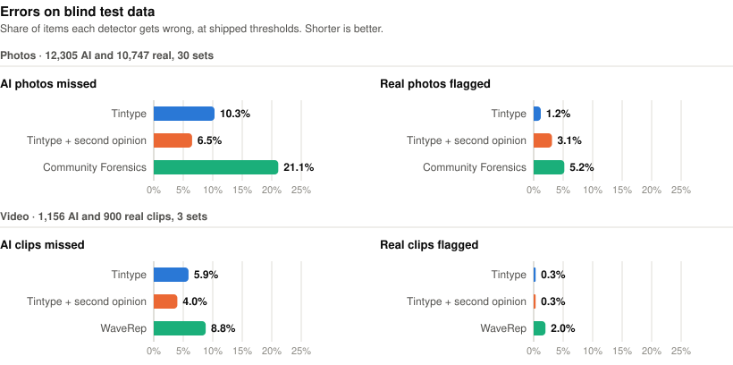
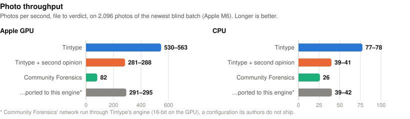
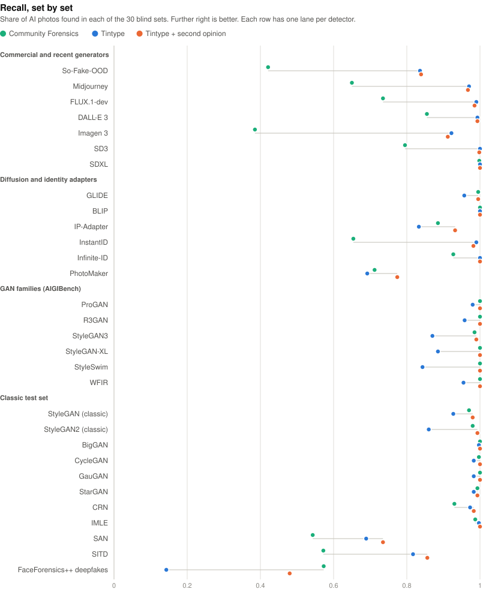
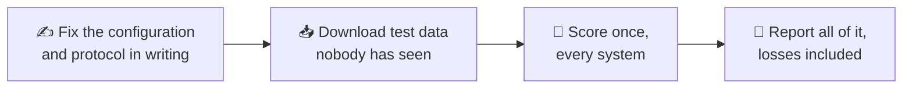
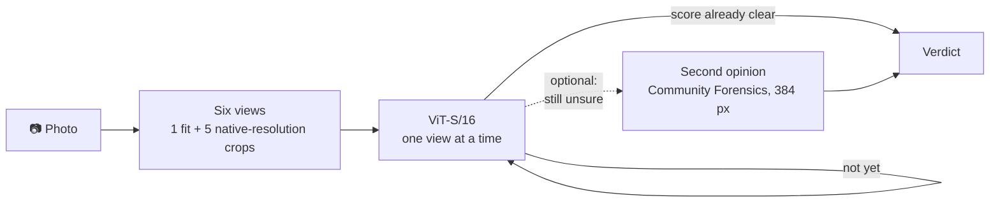

<div align="center">

# Tintype

**Detects AI-generated photos and videos. Small, fast, and written in Rust.**

[](Cargo.toml)
[](#-licence)
[](models/LICENSE.md)
[](#-build-from-source)
[](#-how-it-works)
[](https://github.com/cheesejaguar/tintype/stargazers)

[Website](https://cheesejaguar.github.io/tintype/) · [Quick start](#-quick-start) · [Results](#-results) · [How it works](#-how-it-works) · [Use](#-use) · [Limits](#%EF%B8%8F-limits) · [Benchmark](docs/BENCHMARK.md)

</div>

One Rust crate and one binary cover inference, training, dataset preparation,
the reference detectors it is compared against, and the evaluation. It needs
no Python and calls no external tool.

```bash
tintype detect holiday.jpg clip.mp4
```

```
AI-GENERATED   0.987  holiday.jpg
likely real    0.021  clip.mp4  [looked at 0–13.1 s of 44.3 s, 8 frames]
```

The number is a detection score between 0 and 1, flagged above 0.5. It is
not a probability that the file is AI-generated ([why](#-reading-the-output)).

| 📷 Photos | 🎬 Video | ⚡ Speed |
|:---:|:---:|:---:|
| **0.988** precision · **0.897** recall | **0.997** precision · **0.941** recall | **530–563** photos/s on an Apple GPU |
| 23,052 photos in 30 blind sets | 2,056 clips in 3 blind sets | 77–78 photos/s on the CPU |

A tintype is a photograph made directly on a metal plate: one exposure, one
original. This project is about telling that kind of picture from the other
kind.

## 🚀 Quick start

```bash
curl -fsSL https://cheesejaguar.github.io/tintype/install.sh | sh
tintype demo
tintype detect photo.jpg clip.mp4
```

On Windows, run this in PowerShell instead.

```powershell
irm https://cheesejaguar.github.io/tintype/install.ps1 | iex
tintype demo
```

The demo scores one bundled image with a known AI-generated label.
`tintype demo --sensitive` runs the same bytes with a lower threshold.

The installers run on Apple silicon macOS, glibc Linux (x86-64, 32-bit x86
or ARM64) and Windows 10 or later (x86-64 or 32-bit x86).
Detection runs on your machine. See [installation and deployment](docs/DISTRIBUTION.md)
for release archives, source builds, model paths and code-only installation.

```bash
tintype batch ./media --json > detections.jsonl
tintype serve --bind 127.0.0.1:8080
```

The recursive scanner streams JSON Lines and keeps its models loaded across
chunks. The server keeps models loaded across requests. See the
[HTTP API](docs/API.md), [Linux container images](docs/DISTRIBUTION.md#published-images), and [agent skill](skills/tintype/SKILL.md).

Install the skill for a supported coding agent after installing the CLI.

```sh
npx skills add cheesejaguar/tintype --skill tintype
```


### Inspect an embedded Content Credential

The optional source build can check embedded C2PA credentials offline.
[Download the signed original](docs/assets/provenance-original.png) and save
it as `provenance-original.png` in the checkout directory.

```sh
cargo build --release --locked --bin tintype --features provenance
target/release/tintype provenance provenance-original.png --json
```

The command reports whether it could verify the credential and what the
active manifest declares about creation. Supply local signer and timestamp
trust lists to verify the signer. The original contains an AI-generation
declaration. The resized demo copy has no embedded credential. See the
[provenance guide](docs/PROVENANCE.md) for trusted verification and the paired
pixel scores.

## 📊 Results

Tintype is compared with released open-weight detectors:
[Community Forensics](https://github.com/JeongsooP/Community-Forensics) for
photos and
[WaveRep](https://github.com/grip-unina/WaveRep-SyntheticVideoDetection) for
video. The charts and default-threshold table below use *blind batches*
scored after the configuration and protocol were committed. Each system
runs at its shipped threshold.

<picture>
  <source media="(prefers-color-scheme: dark)" srcset="docs/assets/errors-dark.svg">
  
</picture>

| | Precision | Recall |
|---|---|---|
| **Photos**, newest blind batch (12,305 AI, 10,747 real) | | |
| Tintype | **0.988** | 0.897 |
| Tintype `--photo-second-opinion` | 0.972 | **0.935** |
| Community Forensics | 0.945 | 0.789 |
| SwinV2 detector | 0.841 | 0.587 |
| **Video**, blind batch (1,156 AI, 900 real) | | |
| Tintype | **0.997** | 0.941 |
| Tintype `--second-opinion` | **0.997** | **0.960** |
| WaveRep | 0.983 | 0.912 |

At a common false-positive budget of 1%, Tintype recovered **88.5%** of AI
images in the 23,052-photo batch, compared with **63.1%** for Community
Forensics and **33.8%** for the SwinV2 detector. The 2,056-clip batch yielded
**96.1%** recall for Tintype and **87.4%** for WaveRep at the same 1% budget.
These operating points were measured retrospectively. The shipped thresholds
flagged 1.21% of real photos and 0.33% of real clips on the respective batches.
[Photo results](docs/results/confirm7.md) · [Video results](docs/results/confirm4.md)

On the 2,281 JPEGs in the So-Fake-OOD social-media subset, Tintype reached
**77.0%** recall at 1% false positives, compared with **46.7%** for SwinV2
and **28.8%** for Community Forensics. The JPEG filter was applied after
scoring. The archived scores reproduce both comparisons.
[Evidence and score archives](docs/EVIDENCE.md)

**External image benchmarks.** After the same JPEG re-encode on 2,038
Arena images, Tintype reached 73.1% recall at 1% false positives and
Community Forensics reached 23.7%. GPTTrace reached 76.7% on the same
JPEGs. On the distorted NTIRE 2026 public
test, Tintype reached 2.2% at that budget. At the shipped cutoff it flagged
155 of the 600 authentic distorted inputs.
[Arena](docs/EVIDENCE.md#ai-detector-arena-v01) · [NTIRE](docs/EVIDENCE.md#cvpr-2026-ntire-public-test)

**Content-matched video.** On 20 scenes with four current generators,
Tintype flagged 72 of 80 generated clips and 3 of 20 authentic clips.
The tested 64-frame WaveRep reference flagged 34 generated and 4 authentic
clips at its shipped cutoff. Both systems used the same normalized clips.
[Methods and scores](docs/EVIDENCE.md#content-matched-generated-video-clips)

<picture>
  <source media="(prefers-color-scheme: dark)" srcset="docs/assets/speed-dark.svg">
  
</picture>

Video runs at about 0.03 s per clip on the GPU (the blind batch of 2,056
clips in 65–67 s); WaveRep as released takes 4.0 s per clip.

### 🧾 What the charts do not show

These results are pooled, and pooled results hide things. The ones that
matter:

- **Not every set is a win.** Community Forensics was trained on thousands
  of older generators and is the stronger detector on GAN images; Tintype is
  far ahead on current commercial generators (on social-media photos from
  them it finds 84% where Community Forensics finds 42%). On the newest
  batch the default profile is at or above Community Forensics on *both*
  precision and recall on 12 of the 30 sets.
- **The photo second opinion closes most of that gap, not all of it.** With
  `--photo-second-opinion` it is 26 of 30. The other four: one real photo
  flagged to none on Midjourney and on WFIR, lower precision with higher
  recall on SAN, and lower recall on face-swap deepfakes (0.480 against
  0.573).
- **The second opinions lean on the other detectors' own networks.**
  `--photo-second-opinion` sends the photos Tintype is not sure about – about
  half of a balanced test set, nine real photos in ten – to Community
  Forensics' released network, and `--second-opinion` sends about one clip in
  eight to WaveRep's. Rows labelled plain "Tintype" use only Tintype's
  weights.
- **Speed depends on what you compare with.** The default profile is 6.5–7×
  (GPU) and 3× (CPU) faster than Community Forensics as its authors release
  it. The grey bars are Community Forensics' network ported to
  Tintype's engine at 16 bits, a configuration nobody ships: against that the
  default is still about twice as fast, and the photo second-opinion mode is
  level, not faster. The default's lead also depends on early exit; looking
  at all six views of every image it is the slower of the two in the same
  engine.
- **The second opinion costs false alarms.** It flags 3.1% of real photos
  where the default flags 1.2% (Community Forensics: 5.2%).
- **Video, one set.** On one of the three video sets the plain video model's
  recall is a hair below WaveRep's (0.966 against 0.970), with higher
  precision.
- **Scope of the blind batches.** The author chose those test sets; several share generator families
  with the training data (through other collections, never the same files);
  and other released detectors – B-Free, GAPL, PGC among them – have not been
  run on them. What the numbers support is "competitive with the released
  baselines it was tested against, on these documented tests", and much less
  on media that has been through a messenger or social app (see
  [Limits](#%EF%B8%8F-limits)).

<details>
<summary><b>Recall on each of the 30 photo sets</b></summary>
<br>

<picture>
  <source media="(prefers-color-scheme: dark)" srcset="docs/assets/recall-by-set-dark.svg">
  
</picture>

Precision, real photos flagged and the exact values for every set are in
[docs/BENCHMARK.md](docs/BENCHMARK.md#blind-batch-7-the-photo-second-opinion).

</details>

[docs/BENCHMARK.md](docs/BENCHMARK.md) has every set of every batch, the
speed tables, how the reference detectors were ported and checked, the Linux
runs, and the other places where Tintype is not ahead.
[docs/RESEARCH.md](docs/RESEARCH.md) is the survey behind the design,
[docs/DATA.md](docs/DATA.md) lists every dataset, and
[docs/PREREGISTRATION.md](docs/PREREGISTRATION.md) is what was fixed in
writing before each blind batch.



## 🧠 How it works



**Several looks at every image.** A detector that only sees a downscaled image
loses the pixel-level fingerprint of the generator; one that only sees a small
native-resolution patch loses the global picture. Tintype runs the same
network on six views and averages the logits:

- a *fit* view – shorter side resized to 256, centre crop 224;
- the centre 224×224 pixels at native resolution, untouched by resampling;
- the four most *textured* 224×224 native-resolution windows. Flat regions
  such as sky or a studio backdrop carry almost no forensic signal, so the
  crops go where the detail is.

**But only as many looks as it takes.** Most images are obvious. The views are
looked at one at a time, most textured crop first, and as soon as the running
score is far enough from the threshold the rest are skipped: about two views
per image on average instead of six. The margins were fitted on the
development sets, where they left pooled precision and recall within 0.002 of
looking at everything. `--all-views` turns this off.

**Video is frames, looked at the same way.** 16 frames are taken evenly across
a clip, each gets the six views, and the clip score is the mean logit. Clips
stop early too: two frames from the first half of the clip, then four, then
all eight of that half, and only then the second half, stopping as soon as
the score is clear. That is about five frames per clip on average, decoding
stops at the half-way mark for the four clips in five decided by then, and on
the 6,783 development and blind clips it changed no verdict. Video has its
own checkpoint: the photo weights trained on for two more phases on clips
only, including the kinds of real footage the photo weights mistook for
generated video (cartoons, animation, gameplay).

**A second opinion, if you want one.** `--second-opinion` sends the clips the
video model is unsure about to the
[WaveRep](https://github.com/grip-unina/WaveRep-SyntheticVideoDetection)
network, re-implemented here in Rust and run on its authors' released
weights. The two models make different mistakes, so together they beat either
alone, and because most clips never reach the second network the pair is
still several times faster than WaveRep by itself. With a second opinion every
frame of every clip is looked at.

**And one for photos.** `--photo-second-opinion` does the same with the
[Community Forensics](https://github.com/JeongsooP/Community-Forensics)
384-pixel network (MIT): a photo the default profile is not sure about is
also scored by it, and the two scores are combined. Community Forensics is
the stronger of the two on images from older GANs, Tintype on current
commercial generators; together they find more than either at a precision
between the two.

**Small network, wide training set.** The network is a plain ViT-S/16 at
224 px. It starts from the Community Forensics 224 px checkpoint (MIT) and is
retrained in four phases on photos, frames and clips from about 1,200
generators – the commercial image generators of 2025–26 and the GAN families
before them – against real photos and footage from sixteen sources. The video
checkpoint is trained on clips from thirty video generators, from open models
to Sora, Veo 3.1 and Gen-3.

**Trained against what happens to media in the wild.** Every training sample is
randomly JPEG-compressed before and/or after resizing, resized with a randomly
chosen kernel and cropped at a random scale; a quarter go through a
messenger-style round trip (long side capped at 960–1700 px, JPEG quality
55–90). Video frames are drawn from clips re-encoded with random H.264 quality
and resolution, so bitrate cannot stand in for the label.

### 🎚️ Four operating points

Each is calibrated on held-out real media so that a set share of real items,
averaged over real sources, scores above 0.5. Precision and recall are from
the newest blind photo batch.

| | Views | Calibrated false-positive rate | Precision / recall | Use |
|---|---|---|---|---|
| default | up to 6 | 1.5% (photos), 0.5% (video) | 0.988 / 0.897 | The balance |
| `--strict` | up to 6 | 0.5% | 0.995 / 0.824 | Review queues where false alarms are costly |
| `--sensitive` | up to 6 | 5% | 0.963 / 0.960 | Triage, where a missed fake costs more than a false alarm |
| `--fast` | 2 | 0.5% | 0.995 / 0.767 | Bulk scanning at the highest throughput |

## ⚙️ Engines

| Engine | Where | Notes |
|---|---|---|
| `gpu` (default on macOS) | Apple GPU, 16-bit | The whole network is compiled into one MPSGraph, driven from Rust through `objc2`. Training uses the same graph builder, with autodiff and AdamW inside the graph. |
| `gpu-f32` | Apple GPU, 32-bit | Matches PyTorch output to five decimals. |
| `cpu` | Anywhere | An engine written for this network. The matrix products go to Accelerate on macOS and to pure-Rust kernels (NEON, AVX2 or AVX-512, chosen at run time) on Linux and Windows. |

Images are decoded and resized in Rust (`image`, `zune-jpeg`,
`fast_image_resize`) on all cores and fed to the engine through a bounded
queue. Video is decoded in-process by AVFoundation on macOS, with a pure-Rust
fallback that also runs on Linux and Windows (an MP4/MOV parser written for
this project feeding the `rust_h264` and `rust_h265` decoders). The YCbCr→RGB conversion
is done in Rust either way.

Some views of an image are the same pixels: below 224 pixels the centre crop
and the four textured crops are one upscaled crop, an image with few crop
positions repeats them, and at a shorter side of exactly 256 pixels the
whole-image view is the centre crop. Such a view goes through the network
once and its score counts in each of its places, so the number of views, the
early-exit checks and the mean are unchanged. This is on wherever it leaves
every score bit for bit the same: always on the GPU engines and the pure-Rust
CPU kernels, and with Accelerate for one photo at a time (there a logit
depends in its last bits on how many views run together).
`TINTYPE_VIEW_REUSE=off` turns it off and `=on` forces it on everywhere;
`TINTYPE_STATS=1` prints how many frames were decoded and how many views were
prepared, scored and reused, on standard error
([measurements](docs/runbooks/view-reuse.md)).

Early exit also prepares only what it gets to: a view is cut out, and a
video frame converted to RGB, when a stage is about to score it, so a clip
decided after two frames has two frames converted, not eight. This applies
to a single file on any engine and to many files on the GPU engines; many
files on the CPU engine are prepared up front as before, because there the
network sets the pace and the decoding threads have time to spare.

## 📦 Build from source

```bash
git clone https://github.com/cheesejaguar/tintype && cd tintype
cargo build --release --locked --bin tintype
./target/release/tintype detect photo.jpg clip.mp4
```

A recent stable Rust toolchain builds the executable. The checkout includes
two 87 MB checkpoints and their JSON specs. Run `tintype verify-models`
from the checkout to verify their hashes.

| | macOS on Apple Silicon | Linux and Windows |
|---|---|---|
| `detect`, photos and video | ✅ GPU and CPU | ✅ CPU |
| Second opinions | ✅ | ✅ photos · ❌ video |
| Training and evaluation commands | ✅ | ❌ |

Release builds cover Linux on x86-64, 32-bit x86 (i686) and ARM64, and
Windows on x86-64 and 32-bit x86. The bundled demo image gets the same
score to the last digit from the x86-64 and i686 builds for Linux and
Windows, and the test suite runs on every release target. The 32-bit
builds are slower: on one 4-core x86-64 machine the i686 Linux binary took
2.2 times as long as the x86-64 binary on the same 40 photos. Prefer the
64-bit build wherever the system can run it.

To build on Windows, install Rust with the MSVC toolchain and run the same
`cargo build` command. The executable is `target\release\tintype.exe`. It
links the C runtime statically, so it needs no Visual C++ Redistributable.
For a 32-bit build, add `--target i686-pc-windows-msvc` on Windows or
`--target i686-unknown-linux-gnu` on Linux (with `gcc-multilib` installed).

On Linux (aarch64 Ubuntu, eight virtual cores) `detect` gave the same verdict
as the macOS CPU engine on every one of 16,324 photos of a blind batch, at
35 photos/s against 14–15 for Community Forensics' released pipeline on the
same machine, and scored the blind video batch at 0.43 s per clip with the
same precision and recall as on macOS – on the 1,756 of 2,056 clips its video
reader can open
([the Linux section of the benchmark](docs/BENCHMARK.md#five-speed-changes-before-and-after)).

## 🔍 Use

```bash
tintype detect *.jpg *.mp4                 # human-readable verdicts
tintype batch ./media --json               # recursive scan, one JSON row per file
tintype detect --json suspicious.png       # one JSON object per file
tintype detect --sensitive inbox/*.webp    # looser threshold
tintype detect --strict evidence.jpg       # tighter threshold
tintype detect --fast --device cpu a.jpg   # two views, CPU engine

tintype data baselines                     # fetches the reference detectors' weights, once
tintype detect --photo-second-opinion baselines/commfor-384.safetensors *.jpg
tintype detect --second-opinion baselines/waverep-g4.ckpt *.mp4
```

The WaveRep weights are its authors' and come under their licence (research
and other non-profit use); they are downloaded from the authors' site, not
shipped here. The Community Forensics weights are MIT.

### 📖 Reading the output

- **The score is not a probability.** It is the network's evidence passed
  through the chosen profile's calibration, so the same photo gets a
  different score under `--strict` than under the default. Above 0.5 is
  flagged. `--json` also gives the evidence itself (`logit`, the same under
  every profile), the profile's threshold on it (`threshold_logit`) and the
  `profile` name.
- **A flag is evidence, not a finding.** At the error rates measured on the
  newest blind batch (89.7% of AI photos found, 1.2% of real ones flagged),
  a stream in which one photo in a hundred is AI-generated would have about
  43% of its flagged photos be AI-generated – more than half the flags would
  be on real photos. That is arithmetic, not a measurement of any real
  stream; it is why a flag should lead to a second look, not an accusation.
- **Video verdicts say what they rest on.** Sixteen frames are spread over
  the first 30 seconds of a clip, and a clear clip is decided from the first
  few of them, so most verdicts rest on the first 13 seconds or less. Each
  line gives the latest sampling target represented in the score
  (`analysed_until_s`) and the clip's duration (`duration_s` in JSON).
  The decoder uses the nearest available frame. `--max-seconds 0` spreads the frames over the whole
  clip and `--all-views` looks at every one of them, at a cost in speed:
  ```bash
  tintype detect --max-seconds 0 --all-views --frames 64 long-clip.mp4
  ```
  Even so, a few generated seconds inside a long real video can fall between
  the sampled frames.
- **`INCONCLUSIVE`** means decoding stopped before the verdict had the frames
  it needed (a damaged or cut-off file): the score of the frames that were
  read is shown, with no verdict (`"complete": false` in JSON).
- **Unreadable files** are listed with the reason, and in JSON as
  `{"path": …, "error": …}`.
- **Exit status**: 0 when every file got a result, whether or not anything
  was flagged; 2 when one or more files could not be read (the others are
  still reported); 1 for a setup error. Invalid command syntax also exits with status 2. `--fast`, `--sensitive` and
  `--strict` are photo profiles and are refused for mixed `detect` calls. A mixed `batch` call reports a per-file error for each clip.

## 🧰 Commands

| Command | Purpose |
|---|---|
| `detect` | Verdicts for image and video files |
| `batch` | Recursive directory scanning with streamed JSON Lines |
| `serve` | Local or self-hosted HTTP API |
| `demo` | Score the bundled, labeled sample |
| `verify-models`, `freeze-set`, `verify-set` | Verify released weights and reproduce the exact evaluation inputs |
| `split-groups`, `verify-split` | Divide manifests into fit, calibrate and test sets that keep parents, scenes, sources and generator families together, and fail if any cross ([runbook](docs/runbooks/frozen-eval.md)) |
| `data` | Download and prepare a dataset plan |
| `train` | Fine-tune on image and video manifests |
| `finalize`, `finalize-video`, `calibrate` | Freeze a checkpoint and fit its operating points |
| `evaluate` | Score a whole suite with Tintype and the reference detectors, print tables |
| `score`, `score-video` | Score one manifest (`--reference commfor|swinv2|waverep` runs a reference detector) |
| `report` | Precision, recall, F1, FPR, AUROC, recall at 1% FPR, bootstrap intervals; `--at-rate-of` compares systems at one system's false-positive rate; `--operating-points` gives recall at 0.1% and 1% FPR, the rates at each frozen cutoff with a Clopper–Pearson bound, precision at a stated prevalence, and per-slice tables |
| `latency` | Single-image latency, file to verdict: median, p90 and p95. Runs on every platform with `--device cpu` |
| `profile` | Decoding, cropping and the network timed separately, the network at several batch sizes |
| `ingest`, `index-folder`, `overlap`, `check-videos`, `parquet-info` | Dataset tooling |

## 🔁 Reproduce

The training and benchmark pipeline runs through CLI subcommands.

<details>
<summary><b>The full sequence, from training data to the blind batches</b></summary>

```bash
tintype data train-images && tintype data train-video   # phase-1 data
tintype data phase2 && tintype data phase3              # later additions
tintype data baselines                                    # reference detectors' released weights

tintype train --init baselines/commfor-224.safetensors --init-prefix vit. \
    --manifest data/store/openfake/manifest.tsv ... --out runs/v2 --steps 14000 --p-messenger 0
tintype train --init runs/v2/step_014000.safetensors --manifest ... --out runs/v3 --steps 7000 --lr 2.5e-5 --warmup 300
tintype train --init runs/v3/step_007000.safetensors --manifest ... --out runs/v4 --steps 7000 --lr 2e-5 --warmup 300

tintype data dev && tintype data benchmarks && tintype data confirm1 && tintype data confirm2
tintype finalize runs/v4/step_007000.safetensors          # spec + calibration of every profile

tintype data confirm3 && tintype data confirm5           # the first two blind photo batches
tintype evaluate confirm3 --baselines                     # all systems, all tables
tintype evaluate confirm5 --baselines

# the current photo weights
tintype data phase6
tintype train --init runs/v4/step_007000.safetensors --manifest <photo and phase-1 video stores> ... --out runs/v7 --steps 8000 --lr 2e-5 --warmup 300
tintype finalize runs/v7/step_008000.safetensors --also-trained-on <phase-6 manifests> --also-scored-on <batch 3 and 5 manifests>
tintype data confirm6
tintype evaluate confirm6 --baselines

# the photo second opinion
tintype set-photo-second-opinion --band=-7,0.5,0.5,0
tintype data confirm7
tintype evaluate confirm7 --baselines

# the video checkpoint
tintype data phase4 && tintype data phase5
tintype train --init runs/v4/step_007000.safetensors --manifest <video stores> ... --out runs/v5 --steps 7000 --lr 2e-5 --warmup 300 --p-messenger 0.1
tintype train --init runs/v5/step_007000.safetensors --manifest <video stores> ... --out runs/v6 --steps 4000 --lr 1.5e-5 --warmup 200 --p-messenger 0.1
tintype finalize-video runs/v6/step_004000.safetensors --video-fpr 0.005 --second-opinion=-1,4,1
tintype data confirm4
tintype evaluate confirm4 --baselines
```

</details>

[docs/DATA.md](docs/DATA.md) lists the manifests each training run used.

## ⚠️ Limits

- A detector's verdict is evidence, not proof. Precision below 100% means real
  photos do get flagged, and where AI media is rare most flags can be false
  ([the arithmetic](#-reading-the-output)); do not act on a single score
  where the stakes are high.
- The API is designed for self-hosted deployments. Its application limits
  bound uploads and queued work. Set process memory limits and an ingress
  timeout when accepting untrusted media. See the [server guide](docs/API.md).
- Performance can shift on generators released after the November 2026
  training cutoff. Evaluate on the generators used in your workflow.
- Local edits (inpainting a region of a real photo) and face swaps are out of
  scope; the model is trained on fully generated images. On a face-swap
  deepfake set the default profile finds 14%.
- Media that has been through a messenger or social app is much harder. On
  WhatsApp and Instagram copies of 2026 images the default profile finds
  27–36% of the AI images (flagging under 1% of real ones); `--sensitive`
  finds 55–59% while flagging 2–3%.
- Older generators are a relative weak spot of the default profile: on
  several GAN sets it finds 84–89% where a detector trained on thousands of
  such generators finds nearly all. `--photo-second-opinion` is there for
  that.
- The GPU engine, training, the evaluation commands and the video second
  opinion are Apple-only.
- Video containers and codecs: on macOS the system decoder reads MP4 and MOV
  with H.264, HEVC or MPEG-4 Part 2; AVI and WebM do not work. On Linux and
  Windows the pure-Rust reader takes MP4 and MOV with H.264 or HEVC in 4:2:0
  only – not lossless H.264, MPEG-4 Part 2 or fragmented files – and such
  clips are reported as unreadable. `TINTYPE_DECODER=rust` selects that reader on
  macOS too.

## 📜 Licence

| What | Licence |
|---|---|
| Code | MIT OR Apache-2.0 ([LICENSE-MIT](LICENSE-MIT), [LICENSE-APACHE](LICENSE-APACHE)) |
| Trained weights | CC BY-NC-SA 4.0, because of the training data ([models/LICENSE.md](models/LICENSE.md)). **Non-commercial.** |
| Optional second-opinion weights | Community Forensics: MIT. WaveRep: its authors' non-profit licence. Neither is shipped here. |

Third-party notices: [NOTICE.md](NOTICE.md).
